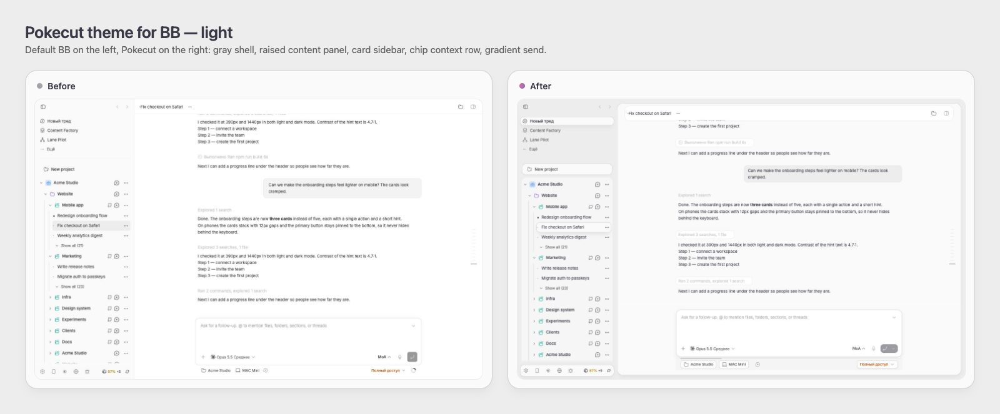
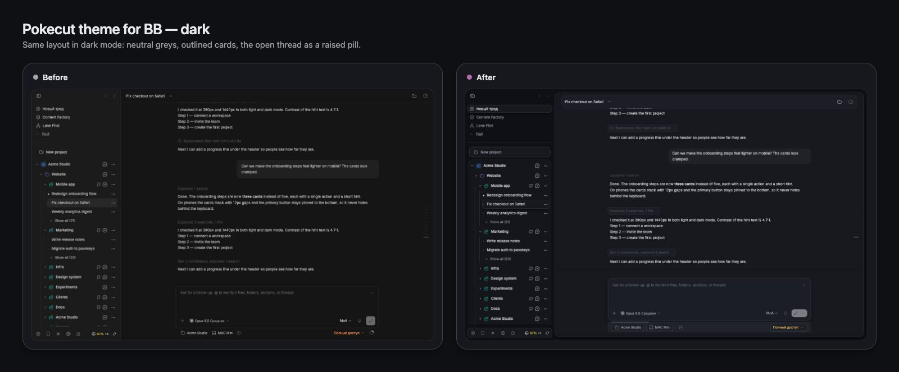
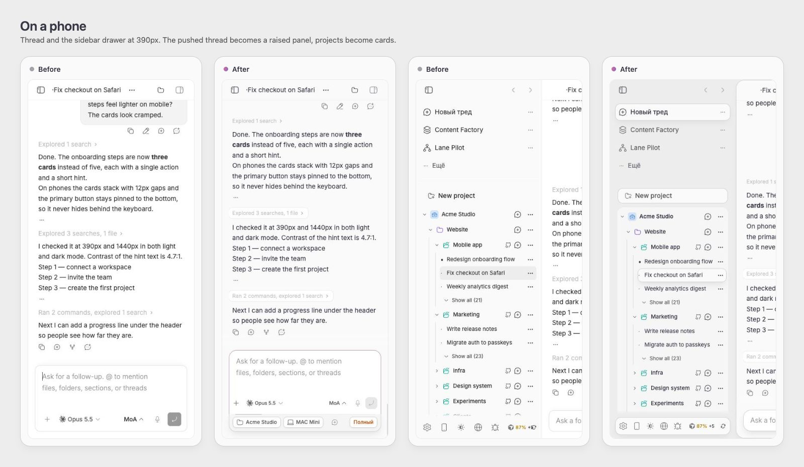

# Pokecut Theme for BB

Pokecut Theme is a BB plugin that provides a light and dark interface theme and optional styling enhancements for BB's chat, timeline, composer, and file views.

BB 0.44 or newer. [Русский](README.ru.md).

The visual language follows the Pokecut admin design. The chat layer and message timestamps include MIT-licensed adaptations; see [NOTICE](NOTICE) for attribution. No Pokecut source, images, or fonts are bundled; BB supplies Inter.





The screenshots use demo content.

## Quick start

```sh
bb plugin install https://github.com/VKirill/bb-plugin-pokecut-theme
bb theme set plugin:pokecut-theme:pokecut
```

Or select **Pokecut** in Settings → Appearance. Reset with `bb theme reset`.

## Documentation

- [Project overview](docs/overview.md)
- [Architecture](docs/architecture.md)
- [Decisions](docs/decisions.md)
- [Theme appearance](docs/features/theme-appearance.md)
- [Chat appearance settings](docs/features/chat-appearance.md)
- [Chat and timeline enhancements](docs/features/chat-enhancements.md)
- [RPC API](docs/api.md)
- [Data model](docs/data-model.md)
- [Development and deployment](docs/deployment.md)
- [Gotchas](docs/gotchas.md)

MIT licensed. See [LICENSE](LICENSE) and [NOTICE](NOTICE) for attribution.
