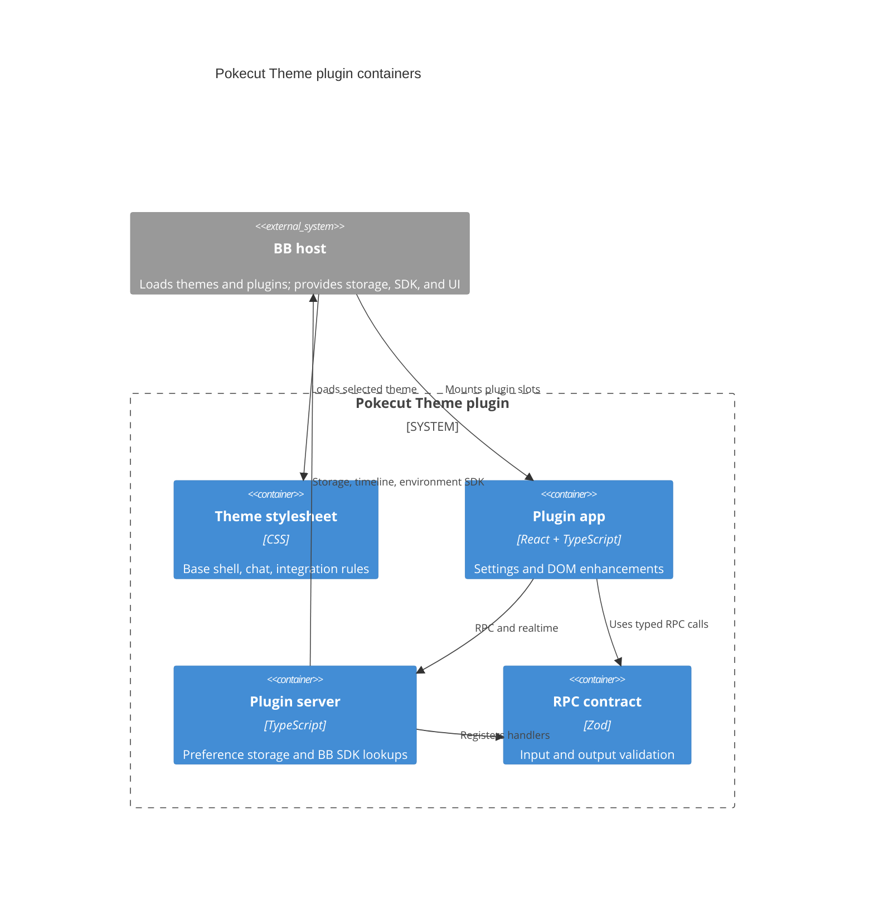

# Architecture

TL;DR: BB loads a generated theme stylesheet, mounts the plugin app and server, and connects the app to the server through the SDK's typed RPC and realtime APIs.

## System context

The plugin runs inside BB. BB supplies theme loading, plugin storage, RPC transport, realtime events, thread timeline data, and navigation (`package.json:16-27`, `server.ts:13-54`, `app.tsx:104-117`).

## Containers

The package manifest points BB at the app, server, and theme CSS entry points (`package.json:16-27`). The contract defines preference, message-time, and thread-root method shapes (`contract.ts:10-36`).

## Building blocks

- Theme source and generated output: `src/theme/` and `themes/pokecut.css`; see [theme appearance](features/theme-appearance.md) (`scripts/build-theme.mjs:4-25`).
- Chat settings and their stored record: `settings.ts`, `settings-section.tsx`, `prefs.ts`; see [chat appearance](features/chat-appearance.md) (`settings-section.tsx:17-46`).
- Runtime enhancements and mode switch: `app.tsx` plus helper modules; see [chat enhancements](features/chat-enhancements.md) (`app.tsx:24-80`).
- Server and RPC contract: `server.ts` and `contract.ts`; see [API](api.md) (`server.ts:21-54`).

## Runtime paths

1. BB starts the plugin app and invokes the server plugin entry point (`package.json:16-27`).
2. The app calls `getPrefs`; the server reads the `prefs` key and normalizes it before returning (`prefs.ts:8-17`, `server.ts:13-24`, `settings.ts:42-49`).
3. If the theme is active, the overlay writes preference attributes to `<html>` and mounts enabled DOM helpers (`app.tsx:27-65`).
4. The settings form sends partial updates; the server normalizes, stores, and broadcasts `prefs-changed` (`settings-section.tsx:37-46`, `server.ts:15-19`).
5. BB SDK calls supply timeline rows and environment roots for message-time and file-preview UI (`server.ts:28-53`).

## Invariants

- Preference values are normalized to the enumerated loader and chip styles and known boolean fields (`settings.ts:4-27`, `settings.ts:42-49`).
- The app's DOM helpers are enabled only while the computed `--pk-theme` value is `pokecut` (`app.tsx:27-29`, `theme-active.ts:6-9`).
- `themes/pokecut.css` is generated from three CSS source files (`scripts/build-theme.mjs:4-25`).
- Preference updates are persisted before the global realtime event is published (`server.ts:15-19`).

## Cross-cutting concerns

**Validation:** Zod defines the RPC contract, while `normalizePrefs` rejects unknown persisted values by falling back to defaults (`contract.ts:10-36`, `settings.ts:42-49`). See [API](api.md).

**Failure handling:** The app reports preference load/save failures in settings; timestamp fetch failures are swallowed and retried on the next refresh (`settings-section.tsx:34-46`, `message-times.ts:80-92`). See [gotchas](gotchas.md).

**Data ownership:** The plugin owns one KV preference object; BB owns timeline and environment records queried by the server (`server.ts:13-14`, `server.ts:28-52`). See [data model](data-model.md).

<!-- lane-pilot:backlinks -->
## Referenced by

- [Theme appearance](features/theme-appearance.md)
- [Pokecut Theme for BB overview](overview.md)
