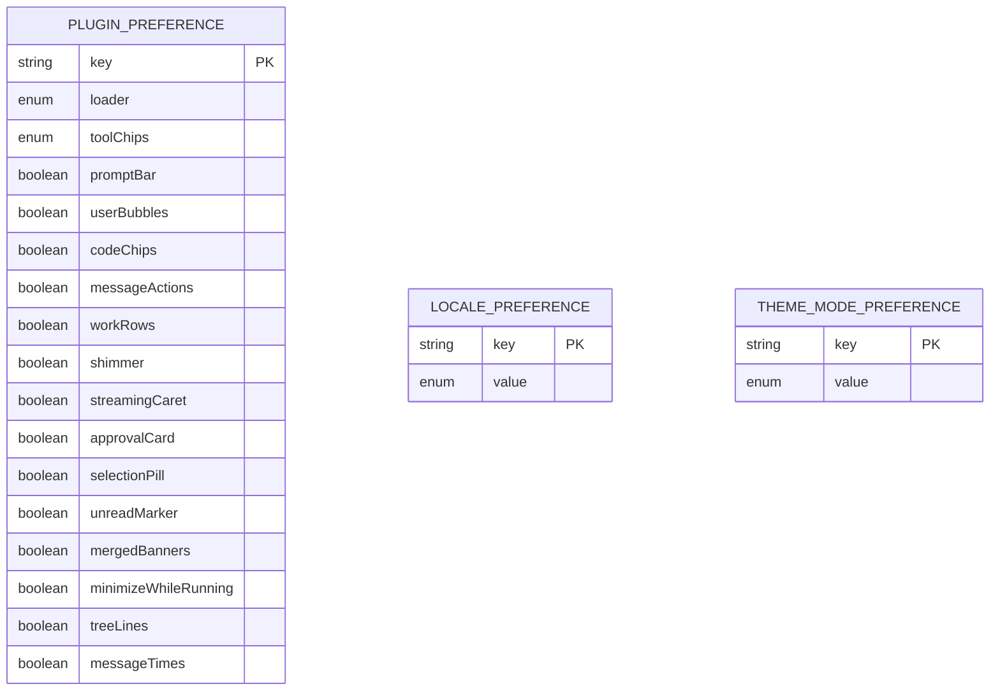

# Data model

TL;DR: The plugin persists one normalized preference object under the KV key `prefs`; locale and theme mode are stored separately in BB browser local storage.

## Schema overview

The plugin KV record is read and written by the server; the complete shape and defaults are defined by `Prefs` and `DEFAULT_PREFS` (`server.ts:13-19`, `settings.ts:29-40`). The locale and theme-mode records are browser local-storage keys (`i18n.ts:145-152`, `theme-mode.tsx:9-25`).

## Tables and fields

### Plugin preference record

**Purpose:** Stores the selected chat loader, tool-row style, and feature switches for the plugin. One value is stored under the key `prefs` (`server.ts:10-17`).

| Field | Meaning | Allowed values / origin |
|---|---|---|
| `key` | KV key identifying this record | Constant `prefs` (`server.ts:10`) |
| `loader` | Pending-row animation selection | `pokecut`, `drive`, `dots`, `orbit`, `coins`, `bb`; defaults to `pokecut` (`settings.ts:4-6`, `settings.ts:36-40`) |
| `toolChips` | Tool-call row surface treatment | `surface`, `outline`, `plain`; defaults to `surface` (`settings.ts:8-9`, `settings.ts:36-40`) |
| `promptBar` | Enables prompt/composer styling helpers | Boolean; defaults `true` (`settings.ts:12-14`, `settings.ts:36-40`) |
| `userBubbles` | Enables user-message bubble styling | Boolean; defaults `true` (`settings.ts:14-15`, `settings.ts:36-40`) |
| `codeChips` | Enables inline code chips and code-block card styling | Boolean; defaults `true` (`settings.ts:15`, `settings.ts:36-40`, `src/theme/chat.css:113-122`) |
| `messageActions` | Enables message-action styling and spatial tooltip helper | Boolean; defaults `true` (`settings.ts:16`, `settings.ts:36-40`, `app.tsx:67-68`) |
| `workRows` | Enables timeline work-row styling and error marks | Boolean; defaults `true` (`settings.ts:17-18`, `app.tsx:48-49`) |
| `shimmer` | Enables label shimmer styling | Boolean; defaults `true` (`settings.ts:18-19`, `settings.ts:36-40`) |
| `streamingCaret` | Enables streaming caret styling | Boolean; defaults `true` (`settings.ts:19-20`, `settings.ts:36-40`) |
| `approvalCard` | Enables approval-card styling | Boolean; defaults `true` (`settings.ts:20-21`, `settings.ts:36-40`) |
| `selectionPill` | Enables selection-pill styling | Boolean; defaults `true` (`settings.ts:21-22`, `settings.ts:36-40`) |
| `unreadMarker` | Enables unread marker styling | Boolean; defaults `true` (`settings.ts:22-23`, `settings.ts:36-40`) |
| `mergedBanners` | Enables merged banner styling | Boolean; defaults `true` (`settings.ts:23-24`, `settings.ts:36-40`) |
| `minimizeWhileRunning` | Enables composer minimization styling while running | Boolean; defaults `true` (`settings.ts:24-25`, `settings.ts:36-40`) |
| `treeLines` | Enables work-tree lines | Boolean; defaults `true` (`settings.ts:25-26`, `settings.ts:36-40`) |
| `messageTimes` | Enables message timestamp decoration | Boolean; defaults `true` (`settings.ts:26-27`, `settings.ts:36-40`) |

### Other client-side values

| Record | Key | Value meaning | Allowed values / origin |
|---|---|---|---|
| Locale preference | `pokecut-theme:locale` | Overrides the UI language detector | `en` or `ru`; missing/invalid value means automatic detection (`i18n.ts:142-152`, `i18n.ts:180-190`) |
| BB theme mode | `bb.theme` | Selects BB's appearance mode | `light`, `dark`, or `system`; unknown or missing values read as `system` (`theme-mode.tsx:9-19`) |

These browser local-storage values are not plugin KV records.

## Status transitions

The plugin preference record has no status-like field. Updates replace its normalized value; reset writes the normalized default object (`server.ts:15-24`).

## Invariants

- A read normalizes the stored object before returning it; absent or invalid values produce defaults (`server.ts:13-14`, `settings.ts:42-49`).
- A write stores the complete normalized preference object, not the partial RPC patch (`server.ts:15-17`).
- Unknown keys and invalid field types are omitted from the normalized object (`settings.ts:42-49`).

## Ownership, reads, retention

| Use case | Writer | Reader | Retention / cleanup |
|---|---|---|---|
| Save chat appearance settings | `setPrefs` server handler via BB plugin KV (`server.ts:15-19`) | `getPrefs`, app overlay, settings form (`server.ts:13-14`, `prefs.ts:8-26`) | Persists in BB plugin storage; no cleanup job appears in this repository (`server.ts:13-19`) |
| Reset chat appearance | `resetPrefs` server handler (`server.ts:22-24`) | Same preference readers | Replaces prior value with defaults |
| Locale choice | Settings section calls `setLocale` (`settings-section.tsx:58-69`) | `detectLocale`, settings section, theme helpers (`i18n.ts:172-190`) | Browser local storage; no cleanup job appears in this repository |
| BB theme mode | Sidebar footer switch writes `bb.theme` (`theme-mode.tsx:43-59`) | BB and `readThemeMode` (`theme-mode.tsx:13-30`) | BB browser local storage; BB owns interpretation |

The server also reads BB-owned thread and environment data to construct transient RPC responses; it does not persist those records (`server.ts:28-53`).

<!-- lane-pilot:backlinks -->
## Referenced by

- [Architecture](architecture.md)
- [Pokecut Theme for BB overview](overview.md)
